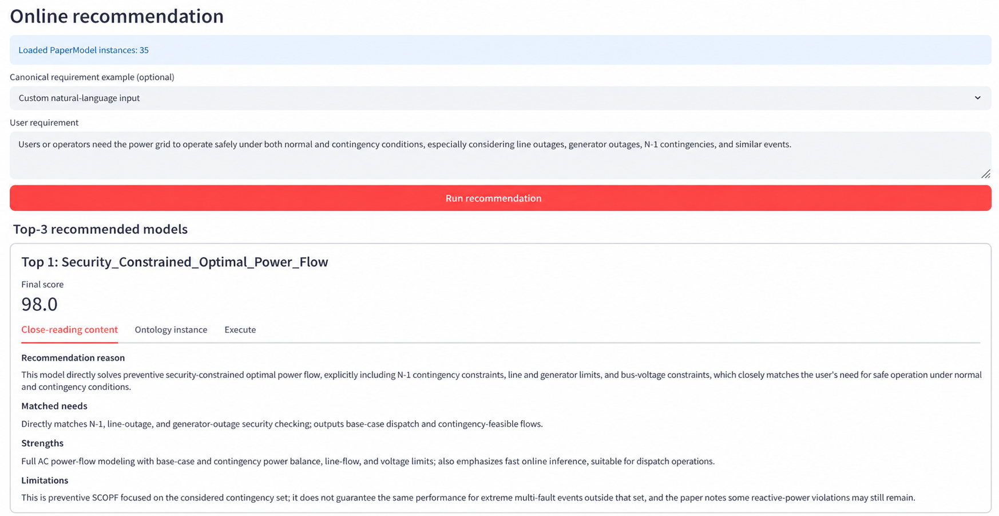
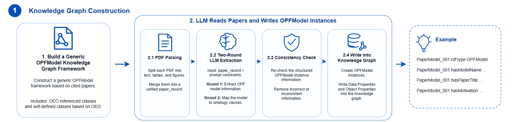
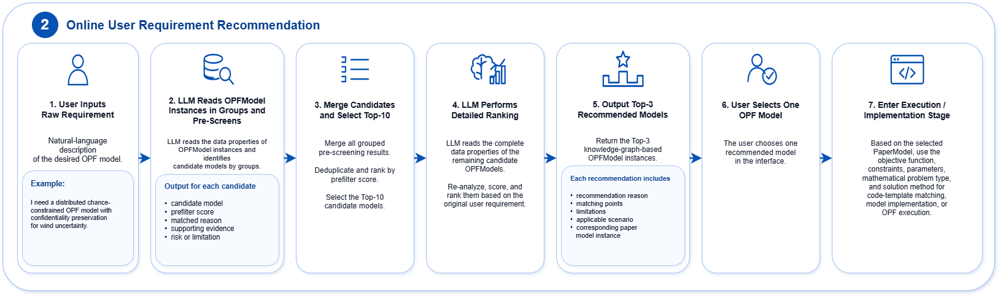

# OntologyOPF

English | [简体中文](README_zh-CN.md)

OntologyOPF turns optimal power flow (OPF) research papers into structured knowledge-graph records, recommends three relevant models for a natural-language requirement, and validates both workflows.

It is a model organization and recommendation tool. It does not solve an OPF problem by itself.



## What the project does

The project has three workflows:

1. **Paper ingestion**

   Upload a paper PDF, extract its PaperModel fields, review the result, and confirm it before writing it to the knowledge graph.

2. **Online recommendation**

   Enter your own requirement or choose one of the 54 prepared requirements. The system compares the requirement with the OPF models in the knowledge graph and returns a Top-3 recommendation.

3. **Validation**

   Compare recommendations and paper records with human-written reference answers. The project reports recommendation quality, field-level semantic similarity, and field-level factual accuracy.





## Current project snapshot

- 36 structured PaperModel records in the knowledge graph.
- 54 natural-language requirements: 19 enterprise/grid requirements and 35 paper-motivation requirements.
- One source citation for every prepared requirement.
- 54 saved Top-3 recommendation groups, stored as 162 rows.
- A public manifest for the 36 papers represented in the graph. P036 is the newly added DeepOPF-V paper; it does not yet have a corresponding paper-motivation requirement, so the fixed M01–M35 requirement set remains unchanged.
- 28 enterprise or grid reports used for manual source tracing.
- Human reference answers and saved Validation results for both the recommendation and paper-ingestion workflows.

The 36 third-party paper PDFs are not included in the public project. Their titles, DOIs, publisher pages, available open-access links, and license information are listed in the [paper manifest](data/02_online_recommendation_workflow/01_input/02_requirement_source_traceability/02_paper_corpus_manifest.csv).

## Quick start

The project was tested on Windows 11 with Python 3.12.10.

Create the local virtual environment and install the pinned top-level dependencies from the project root:

```powershell
py -3.12 -m venv .venv312
.\.venv312\Scripts\python.exe -m pip install --upgrade pip
.\.venv312\Scripts\python.exe -m pip install -r requirements.txt
```

Start the GUI by double-clicking `start_opfmodel_gui.bat`, or run:

```powershell
.\start_opfmodel_gui.bat
```

If the browser does not open automatically, visit `http://localhost:8501`.

## API key

You can view the saved project data and Validation results without an API key.

An API key is needed for new paper extraction, a new online recommendation, an uncached LLM validation step, or a new 54-case recommendation batch.

Before starting the GUI, set `OPENAI_API_KEY` in the same PowerShell window. The default OpenAI route reads it from the current process environment:

```powershell
$env:OPENAI_API_KEY = "your-key-for-this-terminal-session"
```

The project does not load a committed `.env` file. Do not place API keys, account information, or other credentials in the repository.

An RWTH-compatible route is also available in the code. It must be selected in the configuration and uses `RWTH_API_KEY`.

## Using the GUI

### Paper ingestion

Upload one local PDF and review the extracted record. The program writes to the knowledge graph only after manual confirmation.

The canonical knowledge graph is:

```text
data/01_paper_ingestion_workflow/03_output/OPF_Knowledge_Graph2.0.owl
```

The paper-processing files created during a new ingestion run are saved under:

```text
data/01_paper_ingestion_workflow/02_intermediate/01_pdf_processing_outputs/
```

### Online recommendation

Choose a prepared requirement or enter a custom one. The GUI, recommendation Notebook, and batch Validation all use the same 54-case file:

```text
data/02_online_recommendation_workflow/01_input/01_user_requirements.csv
```

Each prepared row includes its source, link, page or section, evidence level, and a short mapping note. A live GUI recommendation stays in the current Streamlit session; it is not appended to the saved 54-case batch history.

### Validation

The Validation page can show or rerun:

- recommendation results compared with the unified 54-requirement human reference file;
- paper-ingestion results compared with the fixed 35-paper human benchmark; P036 is not yet included in this validation benchmark.

Paper-ingestion Validation produces three readable CSV files:

- field-level semantic-similarity details;
- field-level factual-accuracy details;
- one overall summary row.

## Saved Validation results

| Check | Saved result |
| --- | ---: |
| Enterprise candidate Top-3 average | 87.72% |
| Motivation nDCG@3 | 97.38% |
| Paper-field semantic similarity | 64.19% across 891 comparable fields |
| Paper-field factual accuracy | 90.12% (803/891) |

These values describe the saved project snapshot. Running the API workflows again can produce different model text or rankings.

The saved 54-case raw recommendation record is an older audit snapshot. It can still rebuild the saved Top-3 table, but the current resume logic treats it as stale and starts a new API batch because it does not contain the current prompt and model fingerprints.

## Project structure

```text
OntologyOPF/
├─ gui/          Streamlit GUI and its PowerShell launcher
├─ src/          Shared Python modules and three optional Notebooks
├─ ontology/     OPF ontology framework and external reference ontologies
├─ data/         Inputs, intermediate files, and outputs for three workflows
├─ Figure/       README and thesis figures
├─ prompts.toml  Editable natural-language prompts
├─ requirements.txt
└─ start_opfmodel_gui.bat
```

See [data/README.md](data/README.md) for the detailed workflow layout and [ontology/README.md](ontology/README.md) for the difference between the ontology framework and the generated knowledge graph.

## Ontology and knowledge graph

These files have different roles:

- `ontology/OPF_Ontology2.0.owl` is the stable schema and taxonomy used to build category lists and validate records.
- `data/01_paper_ingestion_workflow/03_output/OPF_Knowledge_Graph2.0.owl` is the single integrated graph containing the framework and the current paper-derived instances.

Paper ingestion writes to the second file. Recommendation and Validation read that same file. There is no second knowledge-graph copy under `ontology/`.

## Requirements and source tracing

The single prepared requirement set is [01_user_requirements.csv](data/02_online_recommendation_workflow/01_input/01_user_requirements.csv).

Its human-readable source material is stored under:

```text
data/02_online_recommendation_workflow/01_input/02_requirement_source_traceability/
```

This folder contains 28 enterprise/grid source-report PDFs and the public manifest for 36 papers. Recommendation code does not parse these PDFs or the manifest; it reads the requirement table prepared from these sources and the knowledge graph.

For paper ingestion, the input is a PDF placed in:

```text
data/01_paper_ingestion_workflow/01_input/01_source_papers/
```

## Editing prompts

`prompts.toml` is the single editable source for natural-language prompts used by paper extraction, review, recommendation, translation, and LLM-based Validation.

The file is reloaded when a prompt is built, so a saved edit is used by the next API request without changing Python source. Program-generated JSON schemas and ontology category lists remain controlled by the code and ontology.

## Local model and OCR

Semantic Validation uses `sentence-transformers/paraphrase-multilingual-MiniLM-L12-v2`. The model is about 458 MiB and is not committed. A fresh environment downloads it from Hugging Face on the first semantic-Validation run. Saved CSV results can be viewed without downloading the model.

Text-based PDFs do not need OCR. Scanned PDFs also require the separate Tesseract OCR application on the system `PATH`; installing the `pytesseract` Python package alone does not install Tesseract.

## Optional Notebooks

- `src/OPFModel_KG_Paper_Ingestion.ipynb`
- `src/Online_User_Requirement_Model_Selection.ipynb`
- `src/Validation2.0.ipynb`

The GUI does not execute these Notebooks. It calls the Python modules under `src/opfmodelselection/` directly.

## GitLab upload notes

When you use normal Git commands such as `git add`, `git commit`, and `git push`, the root `.gitignore` excludes local virtual environments, credentials, source-paper PDFs, model caches, and editor caches.

A manual GitLab browser upload does not read the `.gitignore` on your computer. If you upload through the website, select the intended files yourself and do not upload `.venv312`, credentials, private PDFs, or local caches.

## Third-party content and licensing

This repository does not currently include a project-wide `LICENSE` file.

Papers, reports, OEO, CIM, and other third-party materials keep their original copyright and reuse terms. A file being publicly downloadable does not automatically give this project permission to relicense it. Check the source and licence information before redistributing third-party content.
